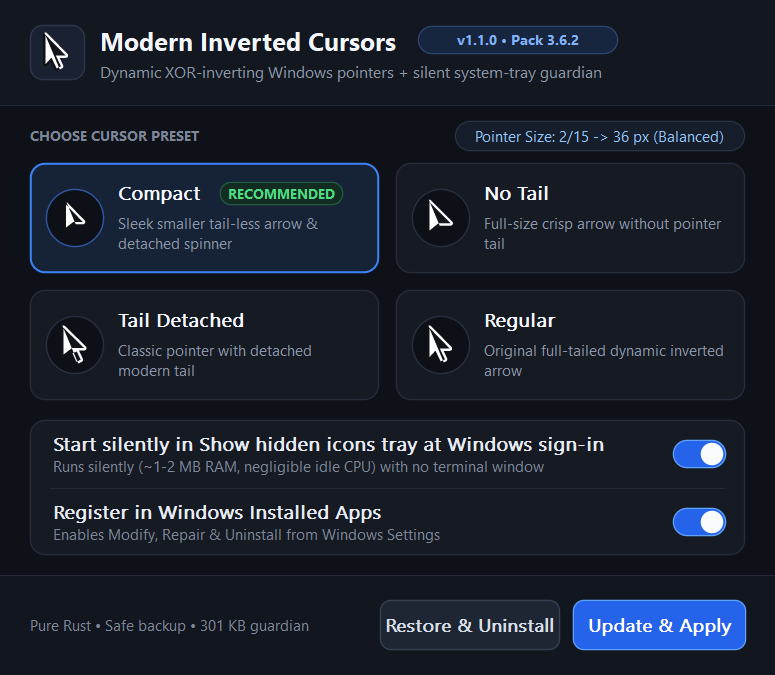
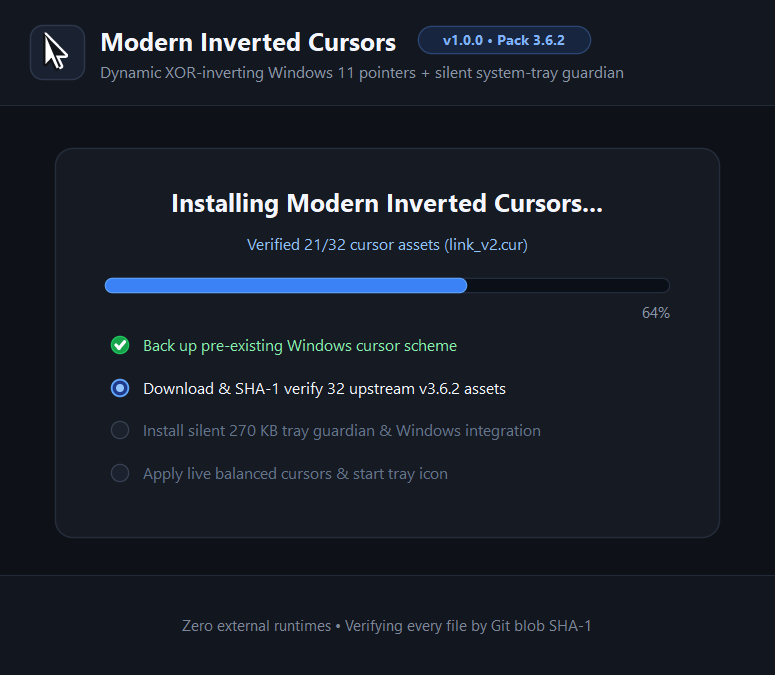
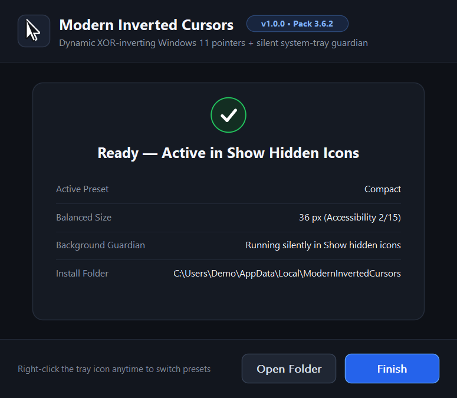

# Modern Inverted Cursors — Windows 7–11 Setup & Tray Guardian (`v1.1.0`)

A lightweight, **pure-Rust (zero external crates)**, **100% FOSS (MIT Licensed)** Windows **7 / 8 / 8.1 / 10 / 11** installer and background system-tray guardian for **[Modern Inverted Mouse Cursors v3.6.2](https://github.com/emvaized/modern_inverted_mouse_cursors)** — preserving true dynamic XOR pixel inversion with balanced pointer sizing and **zero console/terminal windows**.

> **FOSS & Community Contributions Welcome:** Everything here is **100% Free and Open Source Software (MIT License)**. Anyone is free to use, tweak, fork, or build their own version. Report bugs or Windows quirks anytime via **[GitHub Issues](https://github.com/sinethnimsara26/Modern-Inverted-Cursor-Windows11/issues)**.
>
> **Release Series:** **`v1.1.0`** is the hardened, cleanly modularized stable release introducing fail-safe backup validation, readiness handshakes, targeted instance shutdown, sprite-cached UI redraws, and full keyboard accessibility. Historical `v1.0.x` (`v1.0.0`, `v1.0.1`, `v1.0.2`) and `v1.1.0-rc.1` remain preserved in GitHub Releases, and `legacy-v5.1` preserves early V1–V5.1 history.

| Setup Screen | Installing Screen | Done Screen |
| :---: | :---: | :---: |
|  |  |  |

---

## Architecture Highlights (`v1.1.0`)

- **Clean Setup / Guardian Separation:**
  - `ModernInvertedCursors-Setup-v1.1.0-<arch>.exe`: Dark-mode Win32 GUI & headless CLI installer/maintainer (`--silent`, `--modify`, `--uninstall`, `--restore`, `--restore-system-defaults`, `--sandbox`, `--smoke-ui`). Installed alongside the Guardian as `%LOCALAPPDATA%\ModernInvertedCursors\ModernInvertedCursors-Setup.exe` and registered in Windows **Installed Apps** (`ModifyPath`, `UninstallString`, `QuietUninstallString`, `NoModify=0`, `NoRepair=0`).
  - `ModernInvertedCursors-Guardian-v1.1.0-<arch>.exe`: Silent `#![windows_subsystem = "windows"]` system-tray daemon (`~300 KB` x64, `0.46–0.75 MB` idle WS, `~1.5 MB` Private RAM) running in **Show hidden icons** (`Shell_NotifyIconW`).
- **Safety & Reliability Hardening:**
  - **Readiness Handshake & Rollback:** Setup verifies child process survival, `NamedReadyEvent`, tray window PID, and `RuntimeVersion` before reporting success, rolling back cleanly on failure.
  - **Transactional Restore:** Original cursor backup `.reg` (UTF-16LE/UTF-8) is validated (registry header + HKCU cursor scope) *before* touching startup registration, metadata, or files. Existing valid `backup-original.reg` is never overwritten on upgrades from `v1.0.0–v1.0.2`.
  - **Strict CLI & Logging:** Unrecognized CLI flags or unknown presets fail fast (`exit 1`) and log cleanly to `setup-error.log` with zero blocking `MessageBoxW` dialogs in headless modes.
  - **Targeted IPC Shutdown:** Replaced `taskkill /IM` with `CreateToolhelp32Snapshot` + `QueryFullProcessImageNameW` verified `WM_CLOSE` shutdown (bounded wait before targeted fallback).
  - **Security:** `build.rs` fails closed if embedded Guardian PE payload is missing/invalid; System32-pinned `load_system_dll` blocks CWD DLL hijacking; WinHTTP requests enforce TLS 1.2, keep-alive reuse, timeouts, `256 KB` asset caps, and full Git blob SHA-1 checks; `cmd.exe` self-delete uses `MIC_DEL_TARGET` env var cleanly.
- **Performance & Accessibility:**
  - `AssetVerifyCache` skips redundant 32-file disk hashing on hot Guardian reapplies (`3.90×` faster) while preserving cryptographic SHA-1 verification on startup/drift.
  - Single-HKEY `reg_sync_cursor_values` elides no-op registry writes (`3.72×` faster) and removes redundant pre-apply `SPI_SETCURSORS` reloads.
  - `CursorGlyphSprite` + `GlyphSpriteCache` accelerates UI cursor repaints (`289.4×` faster); `WM_PAINT` `BitBlt` dirty-skip and idle `TIMER_ANIM` stop keep idle CPU ~`0%`; full keyboard focus (`Tab`, `Shift+Tab`, arrows, `Space`, `Enter`, `Esc`) tested visually across `100%–200%` DPI.

---

## Quick Install (Windows 7 SP1 through Windows 11 — x64, ARM64 & Legacy x86)

Download the installer matching your Windows version and CPU from **[GitHub Releases](https://github.com/sinethnimsara26/Modern-Inverted-Cursor-Windows11/releases/latest)**:

- **Modern Windows 10 / 11 (x64 Intel/AMD):** `ModernInvertedCursors-Setup-v1.1.0-x64.exe`
- **Modern Windows 11 (ARM64 Snapdragon / Windows on ARM):** `ModernInvertedCursors-Setup-v1.1.0-arm64.exe` *(built & tested natively on GitHub `windows-11-arm` runner)*
- **Legacy Windows 7 SP1 / 8 / 8.1 / 10 (x64):** `ModernInvertedCursors-Setup-v1.1.0-win7-win10-x64.exe` *(Rust `1.75.0` + `+crt-static`, zero external CRT)*
- **Legacy Windows 7 SP1 / 8 / 8.1 / 10 (32-bit x86):** `ModernInvertedCursors-Setup-v1.1.0-win7-win10-x86.exe` *(embedded `asInvoker` + Win7–Win11 manifest)*

Double-click to install or repair, choose a preset (**Compact** recommended), or press `Tab` / Arrow keys + `Enter`.

### Balanced Accessibility Sizing Curve

```text
Step  1 -> 32 px     Step  6 -> 52 px     Step 11 -> 72 px
Step  2 -> 36 px     Step  7 -> 56 px     Step 12 -> 76 px
Step  3 -> 40 px     Step  8 -> 60 px     Step 13 -> 80 px
Step  4 -> 44 px     Step  9 -> 64 px     Step 14 -> 84 px
Step  5 -> 48 px     Step 10 -> 68 px     Step 15 -> 88 px
```

---

## CLI & Automation Flags

```powershell
# Headless unattended install (exits 1 + writes setup-error.log on any error)
.\ModernInvertedCursors-Setup-v1.1.0-x64.exe --silent --preset compact

# Open Setup in maintenance mode against existing installation
"%LOCALAPPDATA%\ModernInvertedCursors\ModernInvertedCursors-Setup.exe" --modify

# Validate backup and restore original Windows cursors cleanly
"%LOCALAPPDATA%\ModernInvertedCursors\ModernInvertedCursors-Setup.exe" --uninstall
.\ModernInvertedCursors-Setup-v1.1.0-x64.exe --restore

# Isolated non-destructive sandbox install & multi-DPI UI smoke renders
.\ModernInvertedCursors-Setup-v1.1.0-x64.exe --sandbox C:\Temp\cursor-test --preset compact
.\ModernInvertedCursors-Setup-v1.1.0-x64.exe --smoke-ui C:\Temp\ui-smoke --dpi 144

# Direct Guardian tray & sandbox controls
"%LOCALAPPDATA%\ModernInvertedCursors\ModernInvertedCursors-Guardian.exe" --tray
"%LOCALAPPDATA%\ModernInvertedCursors\ModernInvertedCursors-Guardian.exe" --quit
```

---

## Repository Structure

```text
.
├── Cargo.toml                         # Version 1.1.0, rust-version 1.75.0, zero external crates
├── build.rs                           # Fail-closed embedded Guardian gate + asInvoker Win7-11 manifest
├── build.ps1                          # Build Guardian -> Setup -> cargo test -> SHA256SUMS.txt
├── src/
│   ├── lib.rs                         # Core exports & unit tests
│   ├── registry.rs                    # HKCU Registry, single-HKEY scheme sync, System32 DLL loader, CLI validation
│   ├── assets.rs                      # 32 pinned v3.6.2 assets, WinHTTP session reuse, AssetVerifyCache & SHA-1
│   ├── cursors.rs                     # Pre-validated atomic LoadImageW + SetSystemCursor application
│   ├── backup.rs                      # UTF-16LE/UTF-8 .reg parser & transactional restore
│   ├── ipc.rs                         # NamedReadyEvent & targeted PID/path-verified Guardian shutdown
│   ├── render.rs                      # 4x4 supersampled CursorGlyphSprite + HICON generator
│   └── bin/
│       ├── guardian.rs                # Silent system-tray guardian + isolated --sandbox mode
│       └── setup/{main,install,ui}.rs # Dark-mode Win32 Setup/Maintenance app
├── tests/integration_hardening.rs     # Migration, corrupt-backup & CLI/asset integration tests
└── docs/                              # Architecture, Bug/Security Audits, Performance, Test Matrix & Journal
```

---

## Build & Verify from Source

Requires Rust `1.99.0` (modern) or Rust `1.75.0` (legacy Windows 7–10 targets; zero external crates needed):

```powershell
cargo fmt --check
cargo clippy --all-targets -- -D warnings
powershell -ExecutionPolicy Bypass -File .\build.ps1 -Arch x64 -Suffix x64
```

See [docs/TESTS_AND_BENCHMARKS.md](docs/TESTS_AND_BENCHMARKS.md), [docs/PERFORMANCE_REPORT.md](docs/PERFORMANCE_REPORT.md), [docs/BUG_AUDIT.md](docs/BUG_AUDIT.md), [docs/SECURITY_AUDIT.md](docs/SECURITY_AUDIT.md), and [docs/KNOWN_ISSUES.md](docs/KNOWN_ISSUES.md).

## License & Upstream Attribution

- Cursor assets downloaded cleanly over HTTPS and verified by Git blob SHA-1 from **[emvaized/modern_inverted_mouse_cursors v3.6.2](https://github.com/emvaized/modern_inverted_mouse_cursors)** (MIT). See [UPSTREAM.md](UPSTREAM.md).
- Setup & Guardian source code is MIT Licensed ([LICENSE](LICENSE)).
